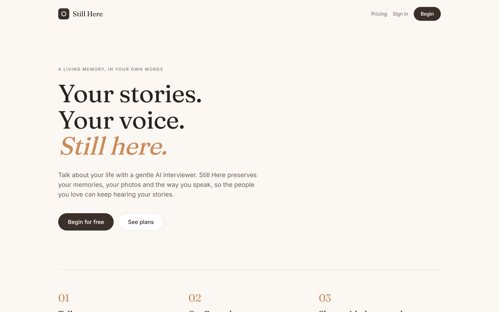
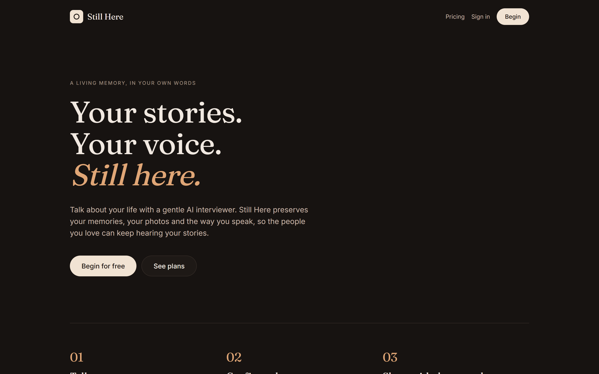
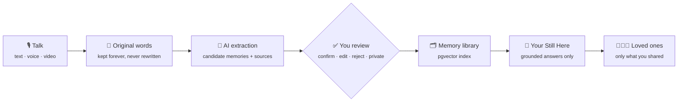
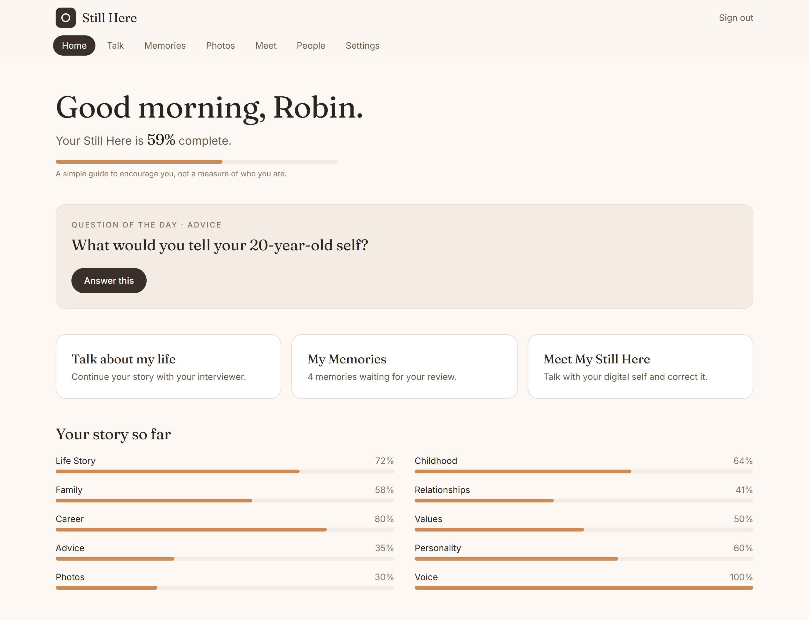
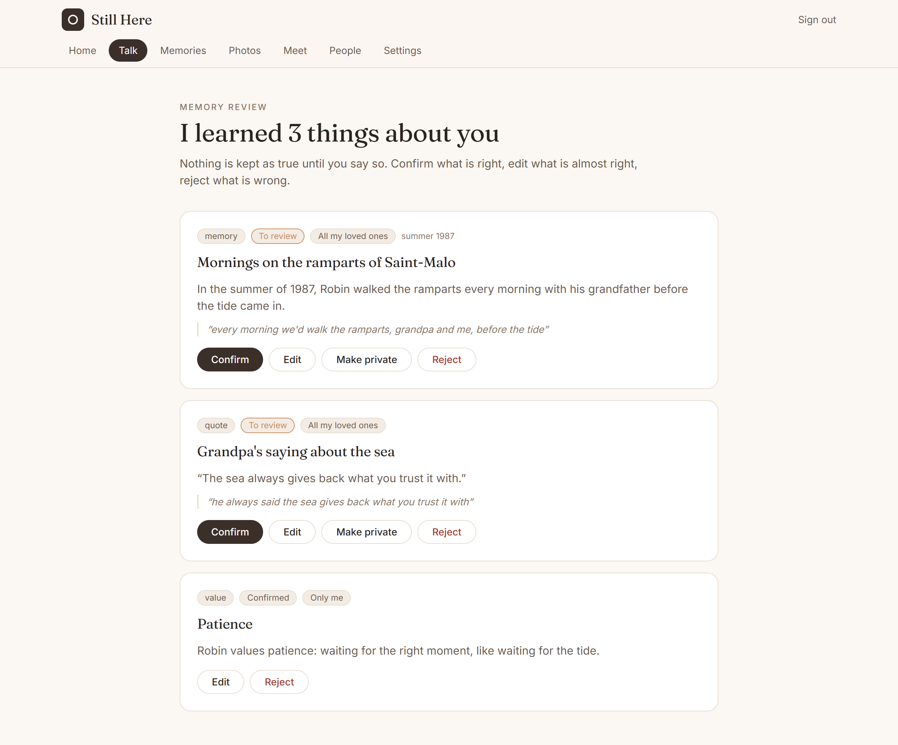
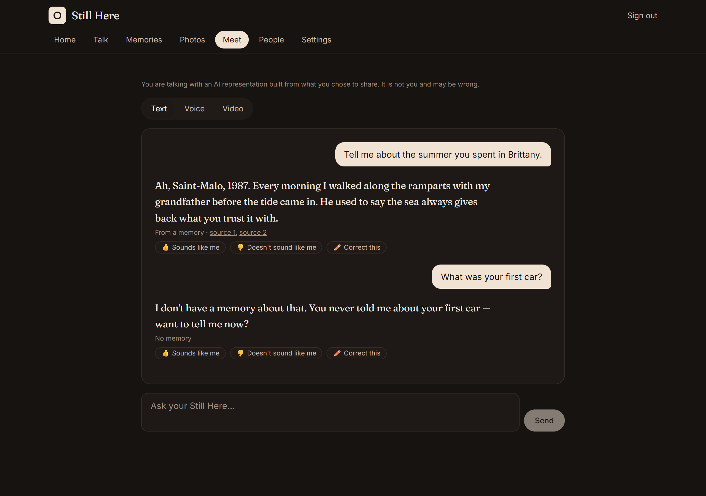
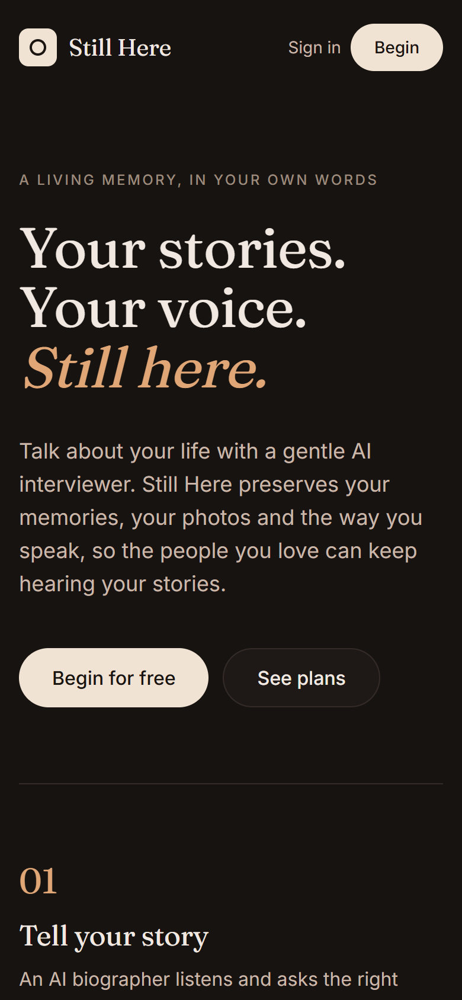
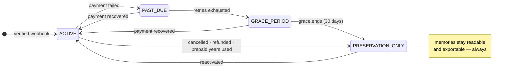
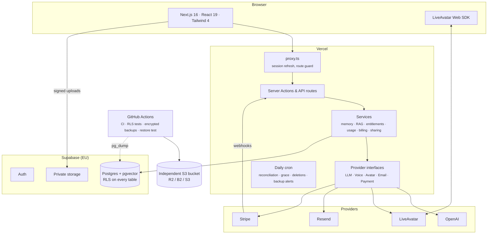

<p align="center">
  
</p>

<p align="center">
  <strong>A living memory, in your own words.</strong><br>
  Tell your life story to a gentle AI interviewer, confirm what matters, and let the people you love keep hearing your stories — grounded only in what you chose to share.
</p>

<p align="center">
  <a href="https://github.com/RobinBeraud/still-here/actions/workflows/ci.yml"></a>
  
  
  
  
  
</p>

---

<p align="center">
  
  
</p>

## Why Still Here

Most of what makes a person — the stories, the expressions, the advice, the way they laugh about their own mistakes — is never written down. Still Here lets someone build, **while they are alive**, a digital memory of themselves: an archive of their own words, photos and voice, and a conversational "Still Here" their loved ones can talk to.

It is built around one non-negotiable idea:

> **The avatar is not the person.** Still Here always presents itself as an AI representation, never invents a memory, and only uses what its owner explicitly confirmed and chose to share.

## How it works



<table>
  <tr>
    <td width="50%"><p align="center"><sub><b>Home</b> — progress by life area and a question of the day</sub></p></td>
    <td width="50%"><p align="center"><sub><b>Memory review</b> — nothing becomes true until you confirm it</sub></p></td>
  </tr>
  <tr>
    <td width="50%"><p align="center"><sub><b>Meet My Still Here</b> — every answer says where it comes from, or that it doesn't know</sub></p></td>
    <td width="50%" align="center"><p align="center"><sub><b>Mobile-first</b>, light and dark</sub></p></td>
  </tr>
</table>

## Features

| | |
|---|---|
| 🎙️ **AI interviewer** | Natural conversation by text, voice or live video avatar. One question at a time, follow-ups on concrete details, gentle with hard moments, steering toward the least documented areas of your life. |
| 🧠 **Memory Engine** | Each conversation becomes *candidate* memories (people, events, places, values, advice, quotes…) linked to the exact sentences you said. **"Why does Still Here know this?"** always leads back to the source. |
| 📸 **Photos** | Private storage, "Tell me the story behind this photo", your words kept apart from the AI's visual guess. |
| 🗣️ **Personality model** | Communication style only (humour, directness, favourite expressions…) — never a psychological profile. |
| 💬 **Meet My Still Here** | Talk to your digital self. Answers are tagged **Known / Uncertain / No memory**, linked to their sources, and you can correct them (👍 · 👎 · ✏️). |
| 🎥 **Avatar & voice** | Explicit consent → recording → personal avatar via LiveAvatar (HeyGen). The avatar only *speaks* answers produced by the grounded pipeline. |
| 👨‍👩‍👧 **Loved ones** | Single-use invitations, per-memory and per-photo permissions, instant revocation. Their conversations stay private to them. |
| 📦 **Your data is yours** | Full ZIP export readable without Still Here, deletion with re-authentication and a 7-day grace window. |
| 💳 **Billing** | Stripe Checkout, customer portal, entitlements, usage quotas — and a payment failure **never** deletes a memory. |
| 🛟 **Built to last** | Encrypted off-site backups every day, and a real restore test every week. |

## Trust by design

**Grounded, not generative.** The Still Here answers in structured JSON (`answer`, `basis`, `used_memory_ids`). Any source id the model invents is dropped, and "Known" is downgraded to "Uncertain" if no real memory backs it. Stored memories are wrapped as data and sanitised, so a memory, a photo or a loved one's name can never inject instructions.

**Access control in the database.** Every table has Row Level Security (default deny). Semantic search runs as `SECURITY INVOKER` with the *viewer's* session, so a loved one can only ever retrieve what they were granted. The CI proves it on a real Postgres: [24 pgTAP assertions](supabase/tests/rls.test.sql) covering user A vs user B, a loved one, specific permissions and revocation.

**Money never erases a life.** Billing is a state machine where every transition preserves your data:



Webhooks are signed, idempotent (duplicates skipped), order-insensitive (subscription state is always re-read from Stripe) and replayed by a daily reconciliation job. Plans grant **entitlements**, never `if (plan === "legacy")`, so prices, quotas and bundles are data you can experiment with.

## Architecture



Providers are swappable: no OpenAI, LiveAvatar, Resend or Stripe code lives outside [`src/lib/providers/`](src/lib/providers). Memories, relationships and permissions remain usable if any provider disappears.

## Tech stack

**App** Next.js 16 (App Router, Server Actions, `proxy.ts`) · React 19 · TypeScript 7 · Tailwind CSS 4
**Data** Supabase Auth · PostgreSQL 17 · pgvector (HNSW) · Row Level Security · private Storage
**AI** OpenAI (conversation, structured extraction, vision, embeddings, transcription, speech) · LiveAvatar by HeyGen
**Business** Stripe (Checkout, Billing, Portal, webhooks) · Resend
**Ops** Vercel · GitHub Actions · Dependabot · pgTAP · Vitest

## Getting started

```bash
git clone https://github.com/RobinBeraud/still-here.git
cd still-here
npm install
cp .env.example .env.local      # fill in your keys
supabase start                  # local Postgres (Docker), or link a cloud project
supabase db push                # apply migrations
npm run dev                     # http://localhost:3000
```

| Command | What it does |
|---|---|
| `npm run dev` · `build` · `start` | Next.js |
| `npm run typecheck` | TypeScript |
| `npm test` | Unit tests: billing state machine & webhooks, entitlements, anti-hallucination, prompt injection |
| `supabase test db` | RLS tests (user A vs user B vs loved one) |
| `npm run stripe:setup` | Creates Stripe products/prices and links them to plans |
| `npm run avatar:link -- <user> <avatar> [voice]` | Activates a personal avatar created in LiveAvatar |

Going to production takes about 90 minutes: see the step-by-step [deployment guide](docs/DEPLOY.md).

## Project structure

```
src/
  app/
    (auth)/     login · signup · password reset
    (app)/      dashboard · talk · memories · photos · meet · people · shared · settings
    api/        chat · extraction · voice · avatar · billing · stripe webhook · cron
  components/   conversation · memory card · ui
  lib/
    providers/  OpenAI · LiveAvatar · Resend · Stripe (behind interfaces)
    services/   memory · conversation/RAG · prompts · entitlements · usage · billing · sharing · account
supabase/
  migrations/   schema · billing · RLS & access · plans · avatar sessions
  tests/        pgTAP RLS suite
scripts/        Stripe setup · avatar linking · encrypted media backup · restore checks
docs/           product, architecture, security, AI, backup, DR, privacy, billing (French)
```

## Documentation

The full design is documented in French in [`docs/`](docs):

| | |
|---|---|
| [Product](docs/PRODUCT.md) · [Architecture](docs/ARCHITECTURE.md) · [Database](docs/DATABASE.md) | What it does and how it is built |
| [AI & memory](docs/AI_MEMORY.md) | Interview, extraction, RAG, anti-hallucination |
| [Security](docs/SECURITY.md) · [Privacy](docs/PRIVACY.md) | Rules, threat model, consents, processors |
| [Backup](docs/BACKUP.md) · [Disaster recovery](docs/DISASTER_RECOVERY.md) | RPO/RTO, restore procedure |
| [Billing](docs/BILLING.md) · [Pricing experiments](docs/PRICING_EXPERIMENTS.md) | Payments, entitlements, quotas, price tests |
| [Implementation plan](docs/IMPLEMENTATION_PLAN.md) · [Deploy](docs/DEPLOY.md) | Status, definition of done, go-live |

Original specifications: [product & technical spec](docs/specs/Cahier_des_Charges_MVP_V2.txt) · [business addendum](docs/specs/Addendum_Business_Pricing_Payments.txt).

## Status & roadmap

**MVP — code complete, pre-launch.** The full MVP journey is implemented and CI is green (type check, unit tests, build, RLS suite). It has not yet run end-to-end against live providers.

- [x] Interview, memory engine, review, provenance
- [x] Grounded digital self, feedback loop
- [x] Photos, personality, avatar workflow
- [x] Loved ones, permissions, invitations
- [x] Export, deletion, audit, encrypted backups, restore test
- [x] Stripe billing, entitlements, quotas, grace & preservation
- [ ] Production deployment and live end-to-end validation
- [ ] Rate limiting, E2E tests (Playwright), monitoring
- [ ] **V2** — life timeline, family graph, reminiscence sessions, time capsules, legacy contacts, family contributions, gift edition, memory book, MFA, UI i18n

## Ethics

Still Here will never: blur the fact that the avatar is an AI · claim to be conscious or to be the person · invent memories · exploit grief to keep people talking · use someone's avatar for advertising · sell private memories · train external models on them without explicit, informed consent.

---

<p align="center"><sub>Built by <a href="https://github.com/RobinBeraud">Robin Béraud-Sudreau</a> · <i>Your stories. Your voice. Still here.</i></sub></p>
